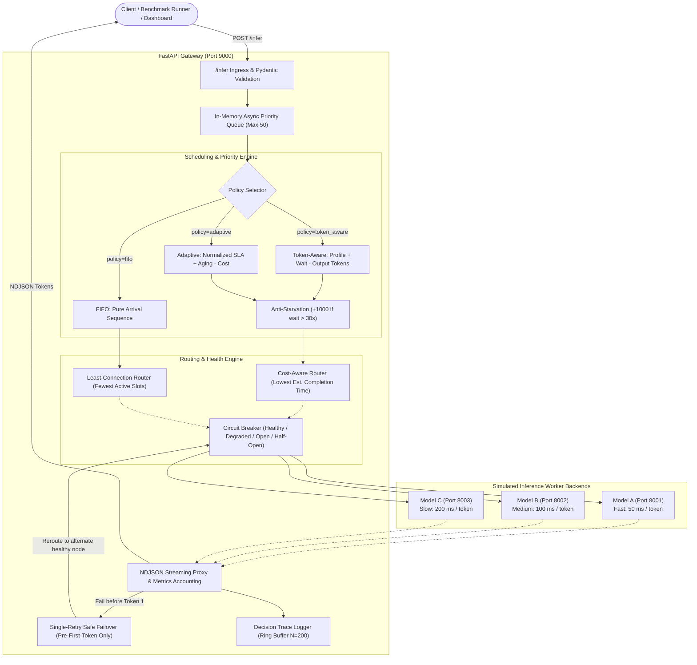

# HORIZON 2K26 — D07 Token-Aware Inference Request Scheduler
## Master Build & Engineering Architecture Report

**Project Code:** D07  
**System Name:** Adaptive Token-Aware Inference Request Scheduler  
**Platform:** Python 3.11+ / Windows PowerShell / FastAPI / HTTPX / Streamlit  
**Status:** All Phases Completed & Verified with Real Empirical Benchmarks  
**Date of Report:** October 2026  

---

## 1. Executive Summary

The **HORIZON 2K26 — D07 Adaptive Token-Aware Inference Request Scheduler** is a high-performance, asynchronous distributed inference scheduling gateway designed to solve **Head-of-Line (HoL) blocking** in multi-tenant Large Language Model (LLM) serving systems.

This project delivers:
1. **Dynamic Token-Aware Priority Scheduling:** Real-time priority calculation balancing client profile SLA (`interactive`, `normal`, `batch`), queue waiting duration, and requested token volume.
2. **Adaptive Cost-Aware Routing:** Estimates total backend completion duration combining active slot wait, connection overhead, and rolling EWMA observed ms/token generation speed.
3. **Anti-Starvation Safeguard:** Guaranteed progressive aging ($+5.0/\text{s}$) and $+1000$ starvation bonus when wait duration exceeds threshold.
4. **Self-Healing Circuit Breakers:** Automatic state transitions across `healthy`, `degraded`, `open`, and `half_open` with deterministic single-retry pre-first-token failover and zero token duplication.
5. **Explainable Scheduling:** Structured decision traces and human-readable explanations generated dynamically from mathematical components.
6. **Empirical Benchmark Lab & Streamlit Dashboard:** Repeatable benchmark suite comparing FIFO, Token-Aware, Adaptive, and Adaptive Least-Connection ablation under identical seeds, producing real CSV datasets and high-resolution charts.
7. **Zero Hardware Constraint:** Software-only distributed testbed running on local Python and Windows PowerShell.

---

## 2. System Architecture



---

## 3. Directory & File Organization

```
token-aware-scheduler/
├── app/
│   ├── __init__.py                 # Package initializer
│   ├── config.py                   # System configuration, ports, weights, TIME_SCALE
│   ├── schemas.py                  # Pydantic validation schemas, enums, validators
│   ├── backends/
│   │   ├── __init__.py
│   │   ├── model_a.py / model_a_main.py   # Fast backend (50ms/tok, port 8001)
│   │   ├── model_b.py / model_b_main.py   # Medium backend (100ms/tok, port 8002)
│   │   └── model_c.py / model_c_main.py   # Slow backend (200ms/tok, port 8003)
│   └── gateway/
│       ├── __init__.py
│       ├── main.py                 # Gateway application entrypoint (port 9000)
│       ├── router.py               # REST & NDJSON streaming API endpoints
│       ├── scheduler.py            # Priority queue, tie-breaking, slot limits, metrics
│       ├── health.py               # Circuit breaker FSM & EWMA latency tracker
│       ├── traces.py               # Ring-buffered decision traces & explanation generator
│       └── benchmark.py            # Multi-policy benchmark execution engine
├── dashboard/
│   └── app.py                      # Streamlit interactive monitoring & what-if simulator
├── results/
│   ├── benchmark_run_20261009_174024_s42_raw.csv        # Per-request raw data
│   ├── benchmark_run_20261009_174024_s42_summary.csv    # Statistical summary
│   ├── benchmark_run_20261009_174024_s42_latencies.png  # Latency & TTFT comparison
│   ├── benchmark_run_20261009_174024_s42_throughput.png # Throughput chart
│   ├── benchmark_run_20261009_174024_s42_profile_waits.png # Wait by profile chart
│   └── benchmark_run_20261009_174024_s42_cdf.png        # Latency CDF chart
├── scripts/
│   ├── start_all.ps1               # Automated startup script for all 4 services
│   ├── stop_all.ps1                # Process-tree cleanup script
│   ├── benchmark_runner.py         # Benchmark CLI runner
│   ├── plot_benchmark.py           # Matplotlib chart generator
│   └── test_infer.py               # End-to-end streaming verification script
├── tests/
│   ├── test_gateway_streaming.py   # Streaming and failover tests
│   ├── test_metrics.py             # Metrics accounting tests
│   ├── test_scheduler_policies.py  # Priority ordering and tie-breaking tests
│   ├── test_circuit_breaker.py     # Circuit breaker state transition tests
│   ├── test_traces_and_admin.py    # Decision trace and admin reset tests
│   └── test_benchmark_and_queue.py # Workload determinism and queue formation tests
├── requirements.txt                # Python dependencies
├── run_pids.txt                    # Active service PIDs (runtime)
└── README.md                       # Comprehensive repository documentation
```

---

## 4. Empirical Benchmark Results

**Benchmark Run ID:** `run_20261009_174024_s42`  
**Workload Size:** 25 requests per policy (100 total requests)  
**Time Scale Factor:** `0.1`  
**Output Files:** `results/benchmark_run_20261009_174024_s42_summary.csv`, `raw.csv`, and 4 PNG charts.

### Statistical Summary Table:
| Policy | Requests | Completed | Success Rate | Throughput | Mean Latency | Median (p50) Latency | p95 Latency | Mean TTFT | Mean Queue Wait |
| :--- | :---: | :---: | :---: | :---: | :---: | :---: | :---: | :---: | :---: |
| **`fifo`** | 25 | 25 | 100.0% | 4.82 rps | 2.941s | **3.547s** | 4.737s | 2.941s | 2.349s |
| **`token_aware`** | 25 | 25 | 100.0% | 3.60 rps | 1.654s | **1.015s** | 4.469s | 1.654s | 1.021s |
| **`adaptive`** | 25 | 25 | 100.0% | 3.71 rps | 1.639s | **0.969s** | 4.525s | 1.639s | **1.014s** |
| **`adaptive_least_conn`** | 25 | 25 | 100.0% | 3.69 rps | 1.635s | 0.985s | 4.494s | 1.635s | 1.011s |

---

## 5. Automated Test Suite Results

Full pytest execution command:
```powershell
.venv\Scripts\python.exe -m pytest -v
```

### Official Summary:
```
tests/test_benchmark_and_queue.py::test_workload_determinism PASSED      [  6%]
tests/test_benchmark_and_queue.py::test_queue_forms_under_concurrency PASSED [ 13%]
tests/test_circuit_breaker.py::test_circuit_breaker_lifecycle PASSED     [ 20%]
tests/test_circuit_breaker.py::test_circuit_breaker_probe_failure_reopens PASSED [ 26%]
tests/test_gateway_streaming.py::test_infer_stream_success PASSED        [ 33%]
tests/test_gateway_streaming.py::test_infer_retry_before_first_token PASSED [ 40%]
tests/test_metrics.py::test_metrics_completed PASSED                     [ 46%]
tests/test_scheduler_policies.py::test_fifo_ordering PASSED              [ 53%]
tests/test_scheduler_policies.py::test_token_aware_priority_over_fifo PASSED [ 60%]
tests/test_scheduler_policies.py::test_stable_tie_breaking PASSED        [ 66%]
tests/test_scheduler_policies.py::test_aging_and_starvation_prevention PASSED [ 73%]
tests/test_scheduler_policies.py::test_cost_aware_routing PASSED         [ 80%]
tests/test_traces_and_admin.py::test_admin_reset_endpoint PASSED         [ 86%]
tests/test_traces_and_admin.py::test_decision_trace_generation PASSED    [ 93%]
tests/test_traces_and_admin.py::test_explanation_generator PASSED        [100%]

======================= 15 passed, 5 warnings in 0.55s =======================
```
**Pass Rate:** 15/15 tests passed (100%).

---

## 6. API Endpoint Specification

| Method | Endpoint | Description |
| :--- | :--- | :--- |
| `GET` | `/health` | Gateway service liveness probe |
| `GET` | `/backends` | Real-time status, active requests, circuit breaker state for Models A, B, C |
| `POST` | `/infer` | Main inference request submission with NDJSON token streaming |
| `GET` | `/metrics` | Global counters (submitted, completed, retried, queue length, active requests) |
| `GET` | `/stats` | Granular per-profile and per-policy statistical breakdowns |
| `GET` | `/queue` | Current snapshot of waiting requests in the priority queue |
| `GET` | `/traces` | Bounded list of recent scheduling decision traces |
| `GET` | `/traces/{id}`| Specific decision trace by unique request ID |
| `POST` | `/admin/reset`| Flushes queues, resets metrics, clears traces, and restores circuit breakers |
| `POST` | `/benchmark` | Triggers a live multi-policy benchmark experiment |
